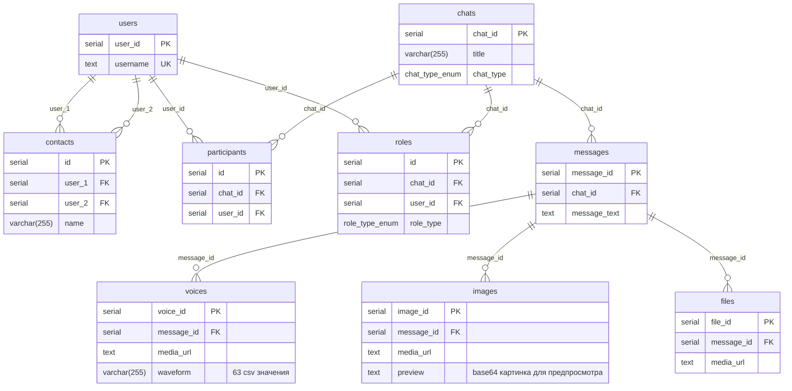

[TOC]

# PostgREST Messenger

Проект содержит пример реализации мессенджера, построенного на системе СУБД **Postgres** + HTTP-сервер **PostgREST**. Также включает пример реализации простого клиента на языке программирования Python (оконный PyQt5).

Используются версии **Postgres** (v18.6 от 13 августа 2026) и **PostgREST** (v16.5 от 20 октября 2026).

## Структура БД

В модели данных предполагается, что каждое сообщение имеет атрибут "текст" даже если текст отсутствует.

Рассматривается псевдонимный вариант чата. БД не хранит личную информацию пользователей такую как: номер телефона, адрес почтового ящика, дату рождения и т.д.

### ERD



### Таблицы

`Users` таблица пользователей. Может хранить имя пользователя, возможно аватар и др. данные.

`Chats` таблица чатов.

`Participants` хранит участников чатов.

`Messages` таблица сообщений. У сообщения всегда есть текст даже если он пустой. Предполагается, что сообщений, где отсутствует текст (например, голосовое или только картинка) будет сильно меньше, чем с текстом.

`Voices` таблица голосовых сообщений. Может содержать вейвформы, длительность и пр.

`Images` таблица изображений. Может содержать картинки с предпросмотром, чтобы не скачивать, например, тяжёлые изображения.

`Files` таблица прикреплённых файлов.

Таблицы `Voices`, `Images` и `Files` хранятся как отдельные таблицы, потому что содержат дополнительные атрибуты. Например, `Voices` могут хранить вейвформу и длительность, `Images` изображения с предпросмотром, а файлы только размер.

`Contacts` todo...

`Roles` todo...

## Настройка окружения (Windows)

Перед началом работы необходимо установить Postgres (запускается как служба Windows) и PostgREST.

### Установка и запуск Postgres

1. Загрузить установочный пакет с официального сайта [Postgres](https://www.postgresql.org/download/) (v18.6 от 13 августа 2026);
2. установить.

### Установка и запуск PostgREST

1. Загрузить исполняемый файл с официального репозитория Github [PostgREST](https://github.com/PostgREST/postgrest/releases/tag/v16.5) (v16.5 от 20 октября 2026);
2. распаковать и прописать путь в системной переменной `Path` для текущего пользователя или системы;
3. если возникает ошибка отсутствия библиотеки `libpq.dll`, необходимо прописать путь к этой библиотеке в системную переменную `Path` (по умолчанию `C:\Program Files\PostgreSQL\18\bin`);
4. (необязательно) полный конфигурационный файл со всеми параметрами можно сгенерировать командой `postgrest -e > postgrest_default.conf` (в проекте уже есть в `server\postgrest_default.conf`); для запуска используется сокращённый `server\postgrest.conf`;

## Запуск

Запуск всей системы от и до заключается в (1) создании и настройке БД на стороне Postgres, (2) запуске HTTP-сервера PostgREST и (3) запуске клиентского приложения.

### Настройка БД

1. Создать БД с именем Messenger `createdb -h localhost -U postgres -E UTF8 -T template0 Messenger`.

   Указывать флаги `-E UTF8 -T template0` необходимо, чтобы БД была в формате UTF8 независимо от локали Windows, а также была поддержка иероглифов, эмодзи и пр. символов;

2. последовательно запустить скрипты для создания схемы:

   ```cmd
   psql -h localhost -U postgres -d Messenger -f .\server\sql\02_create_schema.sql
   psql -h localhost -U postgres -d Messenger -f .\server\sql\03_create_indices.sql
   psql -h localhost -U postgres -d Messenger -f .\server\sql\04_create_triggers.sql
   psql -h localhost -U postgres -d Messenger -f .\server\sql\05_create_views.sql
   psql -h localhost -U postgres -d Messenger -f .\server\sql\06_create_roles.sql
   ```

Запуск последнего скрипта `06_create_roles.sql` особенно важен, т.к. без настройки ролей PostgREST не сможет связаться с БД. В этом скрипте задаётся пароль для доступа со стороны PostgREST, который дальше используется в конфигурационном файле `server\postgrest.conf` через ключи `db-uri` и `db-anon-role`.

`01_drop_schema.sql` можно использовать для быстрого сброса схемы или для повторного развёртывания. **Внимание! Этот скрипт уничтожает все данные относящиеся к БД Messenger.**

### Запуск PostgREST

1. Запустить PostgREST, указав файл конфигурации `postgrest .\server\postgrest.conf`.

Этой командой PostgREST запустит HTTP-сервер. Если запуск прошёл успешно, в консоли можно наблюдать следующие строки:

```text
24/Oct/2026:04:47:59 +0300: Starting PostgREST 16.5...
24/Oct/2026:04:47:59 +0300: Successfully connected to PostgreSQL 18.6 on x86_64-windows, compiled by msvc-19.44.35229, 64-bit
24/Oct/2026:04:47:59 +0300: Config reloaded
24/Oct/2026:04:47:59 +0300: API server listening on 0.0.0.0:3000
```

Сообщение `Cannot decode byte '\xc2'` при запуске PostgREST означает, что Postgres отклонил подключение (неверный пароль в `db-uri` или не создана роль `authenticator`).

### Запуск клиентского приложения (Python)

1. Установить необходимые зависимости:

```cmd
pip install PyQt5
pip install requests
```

2. запустить приложение `python .\client_py\main.py`

### Регистрация и вход

Анонимный пользователь (роль `web_anon`) может только зарегистрироваться (`rpc/register`) и войти (`rpc/login`). Функция `LOGIN` проверяет пароль и возвращает JWT-токен с ролью `web_user`, идентификатором и именем пользователя, токен действует сутки. Клиент передаёт токен в заголовке `Authorization: Bearer <токен>`, PostgREST проверяет подпись и выполняет запрос от роли `web_user`, которой доступны чаты и сообщения.

После входа клиент ищет канал `Test channel` и пишет в него, если канала ещё нет, клиент создаёт его функцией `rpc/create_chat`. Функция создаёт чат, добавляет участников и назначает создателя (`user_id` из токена) владельцем (`Owner`).

## Секреты

Проект содержит несколько «секретов», которые используются только в демонстрационных целях. В реальной системе их необходимо заменить.

- Пароль `mysecretpassword` используется в `06_create_roles.sql` при создании роли `AUTHENTICATOR` и в `server\postgrest.conf` в ключе `db-uri`. При замене пароль нужно поменять в обоих местах.
- Ключ подписи JWT-токенов `secretsecretsecretsecretsecretsecret` используется в `06_create_roles.sql` в настройке БД `app.jwt_secret` (им подписывает токены функция `LOGIN`) и в `server\postgrest.conf` в ключе `jwt-secret` (им PostgREST проверяет токены). При замене ключ (не короче 32 символов) нужно поменять в обоих местах и перезапустить PostgREST.

## Возможные улучшения

1. Разделить таблицу `Chats` на три таблицы по типу чата `PrivateChats`, `GroupChats` и `Channels`. Кажется, что оптимальнее будет хранить раздельно? Поиск по одной из категорий быстрее, тем более вряд ли понадобится поиск по всем категориям одновременно.

   Таблица личных чатов. Хранит такую информацию как название, время создания и пр. В личном чате всегда только два участника, поэтому эта таблица содержит два атрибута с идентификаторами двух пользователей.

   В таблице групповых чатов нужен атрибут создателя чата, чтобы он мог добавлять или удалять участников.

   Таблица каналов возможно могла бы быть частью таблицы `GroupChats`, но только без прав писать у её участников.

2. Таблица многие-ко-многим `UsersChats`, которая применима только для таблиц `GroupChats` и `Channels`. У личных чатов всегда два участника, они хранятся в таблице `PrivateChats`.

3. Таблица `Requests` принятых заявок на вступление в чат. Возможно таблицу можно использовать в качестве ограничения на отправку сообщений? Нет приглашения - нельзя добавить сообщения в базу.

