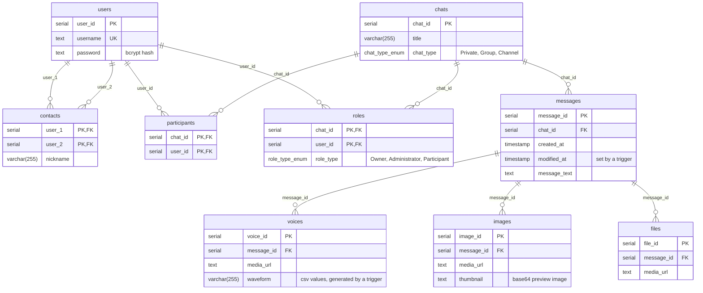

[TOC]

# PostgREST Messenger

**English** | [Русский](README.ru.md)

The project is an example of a messenger built on the **Postgres** DBMS and the **PostgREST** HTTP server. It also includes an example of a simple client written in Python (a PyQt5 desktop application).

The versions used are **Postgres** (v18.6 of 13 August 2026) and **PostgREST** (v16.5 of 20 October 2026).

## Database structure

The data model assumes that every message has a "text" attribute, even when there is no text.

The chat is pseudonymous. The database does not store users' personal information such as phone numbers, email addresses, dates of birth, etc.

### ERD



### Tables

`Users` is the users table. It can store the username, possibly an avatar and other data.

`Chats` is the chats table.

`Participants` stores chat participants.

`Messages` is the messages table. A message always has text, even if it is empty. Messages without text (for example, voice-only or image-only) are expected to be much rarer than messages with text.

`Voices` is the voice messages table. It can contain waveforms, duration, etc.

`Images` is the images table. It can contain preview images, so that, for example, large images do not have to be downloaded.

`Files` is the attached files table.

`Voices`, `Images` and `Files` are stored as separate tables because they have additional attributes. For example, `Voices` can store a waveform and duration, `Images` a preview image, and files only their size.

`Contacts` todo...

`Roles` holds users' roles in chats (`Owner`, `Administrator`, `Participant`). Only `Owner` is used at the moment: the `rpc/create_chat` function makes the chat's creator its owner.

## Environment setup (Windows)

Before starting, install Postgres (it runs as a Windows service) and PostgREST.

### Installing and running Postgres

1. Download the installer from the official [Postgres](https://www.postgresql.org/download/) website (v18.6 of 13 August 2026);
2. install it.

### Installing and running PostgREST

1. Download the executable from the official [PostgREST](https://github.com/PostgREST/postgrest/releases/tag/v16.5) GitHub repository (v16.5 of 20 October 2026);
2. unpack it and add its location to the `Path` system variable for the current user or the whole system;
3. if you get an error about the missing `libpq.dll` library, add the path to that library to the `Path` system variable (by default `C:\Program Files\PostgreSQL\18\bin`);
4. (optional) a full configuration file with all parameters can be generated with `postgrest -e > postgrest_default.conf` (the project already includes it as `server\postgrest_default.conf`); the shortened `server\postgrest.conf` is used to run the server;

## Running

Running the whole system end to end consists of (1) creating and configuring the database in Postgres, (2) starting the PostgREST HTTP server and (3) starting the client application.

### Database setup

1. Create a database named Messenger: `createdb -h localhost -U postgres -E UTF8 -T template0 Messenger`.

   The `-E UTF8 -T template0` flags are needed so that the database uses UTF8 regardless of the Windows locale and supports CJK characters, emoji and other symbols;

2. run the schema scripts in order:

   ```cmd
   psql -h localhost -U postgres -d Messenger -f .\server\sql\02_create_schema.sql
   psql -h localhost -U postgres -d Messenger -f .\server\sql\03_create_indices.sql
   psql -h localhost -U postgres -d Messenger -f .\server\sql\04_create_triggers.sql
   psql -h localhost -U postgres -d Messenger -f .\server\sql\05_create_views.sql
   psql -h localhost -U postgres -d Messenger -f .\server\sql\06_create_roles.sql
   ```

Running the last script, `06_create_roles.sql`, is especially important, because without the roles PostgREST cannot connect to the database. The script creates the `authenticator`, `web_anon` and `web_user` roles (see [Roles and permissions](#roles-and-permissions)), grants their permissions and sets the JWT signing key in the `app.jwt_secret` database setting. The `authenticator` password is used in the `db-uri` key of `server\postgrest.conf`, and the `web_anon` role is named in the `db-anon-role` key. The script can be run again; restart PostgREST afterwards.

`01_drop_schema.sql` can be used to quickly reset the schema or to redeploy. **Warning! This script destroys all data in the Messenger database.**

### Running PostgREST

1. Start PostgREST with the configuration file: `postgrest .\server\postgrest.conf`.

This command starts the HTTP server. If it started successfully, the console shows the following lines:

```text
24/Oct/2026:04:47:59 +0300: Starting PostgREST 16.5...
24/Oct/2026:04:47:59 +0300: Successfully connected to PostgreSQL 18.6 on x86_64-windows, compiled by msvc-19.44.35229, 64-bit
24/Oct/2026:04:47:59 +0300: Config reloaded
24/Oct/2026:04:47:59 +0300: API server listening on 0.0.0.0:3000
```

The message `Cannot decode byte '\xc2'` when starting PostgREST means that Postgres refused the connection (a wrong password in `db-uri`, or the `authenticator` role was not created).

### Running the client application (Python)

1. Install the dependencies:

```cmd
pip install PyQt5
pip install requests
```

2. start the application: `python .\client_py\main.py`

### Registration and login

An anonymous user (the `web_anon` role) can only register (`rpc/register`) and log in (`rpc/login`). The `LOGIN` function checks the password and returns a JWT with the `web_user` role, the user's id and username; the token is valid for one day. The client sends the token in the `Authorization: Bearer <token>` header, and PostgREST checks its signature and runs the request as the `web_user` role, which has access to chats and messages.

After login, the client looks for the `Test channel` channel and writes to it; if the channel does not exist yet, the client creates it with the `rpc/create_chat` function. The function creates the chat, adds the participants and makes the creator (the `user_id` from the token) its owner (`Owner`).

## Roles and permissions

PostgREST connects to the database as the `authenticator` role and, for each request, switches (`SET ROLE`) to the role from the JWT, or to `web_anon` for requests without a token. The roles' permissions are set by the `06_create_roles.sql` script.

| Role | Purpose | Permissions |
|---|---|---|
| `authenticator` | PostgREST's connection to the database (`LOGIN`, `NOINHERIT`) | no data permissions of its own, can only switch to `web_anon` and `web_user` |
| `web_anon` | anonymous user, a request without a token | read `users_public`, call `rpc/register` and `rpc/login` |
| `web_user` | a user logged in through `rpc/login` | read `users_public` and `chats`, read and send messages through `messages_public`, call `rpc/create_chat` |

`web_anon` and `web_user` have no direct access to the tables (except reading `chats`); data is accessed through views (`*_public`) and functions. The `register`, `login` and `create_chat` functions are declared `SECURITY DEFINER` and run with their owner's privileges, so they can, for example, insert a user into the `users` table, which the calling role cannot access. The right to call all other functions in the schema, including the `pgcrypto` extension functions, is revoked; otherwise PostgREST would expose them as `rpc/...`.

## API

PostgREST automatically builds an HTTP API from the objects in the `public` schema: views and tables are available at `/<name>`, functions at `/rpc/<name>`. Below are the requests the client uses (the server is `http://localhost:3000` by default).

| Request | Role | Description |
|---|---|---|
| `POST /rpc/register` | `web_anon` | registration, body `{"username": "...", "password": "..."}`, the password must be at least 8 characters |
| `POST /rpc/login` | `web_anon` | login, same body as `register`, response `{"token": "<JWT>"}`, HTTP 403 for a wrong username or password |
| `GET /users_public` | `web_anon`, `web_user` | list of usernames |
| `GET /chats?title=eq.<title>&chat_type=eq.Channel` | `web_user` | find a chat by title and type |
| `POST /rpc/create_chat` | `web_user` | create a chat, body `{"title": "...", "chat_type": "Channel", "usernames": []}`, response is the chat id |
| `GET /messages_public?chat_id=eq.<id>&order=created_at.asc` | `web_user` | a chat's messages, sorted by time |
| `POST /messages_public` | `web_user` | send a message, body `{"chat_id": <id>, "message_text": "..."}` |

Requests made as `web_user` send the token in the `Authorization: Bearer <token>` header.

## Secrets

The project contains several "secrets" that are used for demonstration purposes only. They must be replaced in a real system.

- The password `mysecretpassword` is used in `06_create_roles.sql` when creating the `AUTHENTICATOR` role and in the `db-uri` key of `server\postgrest.conf`. When replacing it, change it in both places.
- The JWT signing key `secretsecretsecretsecretsecretsecret` is used in `06_create_roles.sql` in the `app.jwt_secret` database setting (the `LOGIN` function signs tokens with it) and in the `jwt-secret` key of `server\postgrest.conf` (PostgREST checks tokens with it). When replacing the key (at least 32 characters), change it in both places and restart PostgREST.

## Possible improvements

1. Split the `Chats` table into three tables by chat type: `PrivateChats`, `GroupChats` and `Channels`. Storing them separately may be more efficient: searching within one category is faster, and searching all categories at once is unlikely to be needed.

   The private chats table stores information such as the title, creation time, etc. A private chat always has exactly two participants, so this table has two attributes holding the two users' ids.

   The group chats table needs a chat creator attribute, so that the creator can add or remove participants.

   The channels table could perhaps be part of the `GroupChats` table, but without write permission for its participants.

2. A many-to-many `UsersChats` table, which applies only to `GroupChats` and `Channels`. Private chats always have two participants, which are stored in the `PrivateChats` table.

3. A `Requests` table of accepted requests to join a chat. Perhaps it could be used to restrict sending messages: no invitation, no messages in the database.

## License

The project is distributed under the MIT license, see the [LICENSE](LICENSE) file.
